# 第八週作業 #13：IC 設計的 EDA 是什麼？

**課程名稱：** 現代程式語言  
**班級：** 資工二  
**學號：** 111410505  
**姓名：** 翁沂慶

## 一、AI 輔助學習與實作

### 1. 使用的 AI 工具

本次作業使用 **ChatGPT** 作為輔助學習工具，搭配 veryl2chip IDE 與 nand2tetris HDL 模擬器，了解 IC 設計的 EDA 流程。

### 2. AI 協助的內容

1. **理解 EDA 概念**：透過 ChatGPT 了解電子設計自動化的用途，以及模擬、合成、佈局、繞線與時序分析的差異。
2. **HDL 程式學習**：利用 AI 協助理解 AND 邏輯閘如何由 NAND 和 NOT 組成。
3. **軟體操作指導**：依照 AI 提供的步驟，實際操作 veryl2chip IDE 的 Blinky LED 範例。
4. **分析實作結果**：將測試、波形、LUT4 映射、FPGA 佈局及時序分析的截圖提供給 AI，協助解釋結果。
5. **報告整理**：利用 AI 協助整理 Markdown 格式，完成 GitHub README.md 報告。

## 二、作業目的

認識 EDA（Electronic Design Automation，電子設計自動化）的概念，實際操作線上電路工具，了解從硬體描述語言（HDL）、功能模擬、邏輯合成，到 FPGA 技術映射、佈局、繞線與靜態時序分析的流程。

## 三、EDA 是什麼？

EDA 是用來協助電子電路與積體電路（IC）設計、驗證及最佳化的軟體技術。工程師先以 HDL 描述硬體行為，再透過模擬確認功能、以邏輯合成轉換成邏輯元件，並進行佈局、繞線和時序分析，減少實作前的設計問題。

| 階段 | 主要作用 |
|---|---|
| HDL 設計 | 描述電路的輸入、輸出與內部邏輯 |
| 功能模擬 | 測試不同輸入下的電路行為 |
| 邏輯合成 | 將 HDL 轉成邏輯閘及暫存元件 |
| 技術映射 | 將邏輯對應到目標 FPGA 的 LUT、暫存器等資源 |
| Placement（佈局） | 為邏輯元件安排位置 |
| Routing（繞線） | 連接元件之間的訊號路徑 |
| Timing（STA） | 分析訊號延遲與關鍵路徑 |

## 四、使用工具

1. [veryl2chip IDE](https://ccc-eda.github.io/veryl2chip/web/dist/index.html)：操作 Blinky LED 範例，查看模擬、合成及 FPGA 設計流程。
2. [nand2tetris HDL 模擬器](https://ccc-js.github.io/hack-computer/dist/hdl.html)：測試 AND 邏輯閘並檢視電路圖。

## 五、實作一：AND 邏輯閘

使用 NAND 接上 NOT，實作 AND 的功能。

```hdl
CHIP And {
    IN a, b;
    OUT out;

    PARTS:
    Nand(a=a, b=b, out=n);
    Not(in=n, out=out);
}
```

測試使用以下四組輸入：

| a | b | out |
|---:|---:|---:|
| 0 | 0 | 0 |
| 0 | 1 | 0 |
| 1 | 0 | 0 |
| 1 | 1 | 1 |

模擬器顯示綠色「通過」，且輸出符合真值表。

**圖 1：AND 邏輯閘模擬通過**

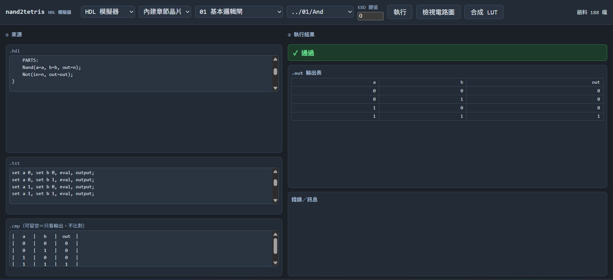

**圖 2：由 NAND 和 NOT 組合的 AND 電路圖**

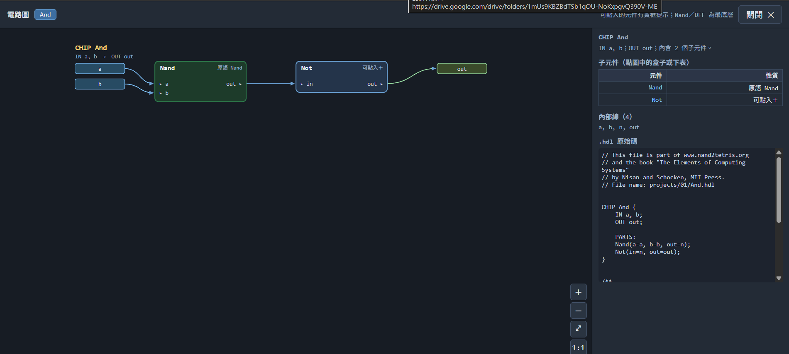

## 六、實作二：veryl2chip Blinky LED 範例

在 veryl2chip IDE 選擇「第 1 課 Blinky 閃爍 LED」，使用 `blinky.veryl` 範例。此電路以時脈驅動計數器，控制 LED 輸出。

### 1. 功能測試

使用 `TestBlinky` 執行 testbench，畫面顯示 **1 個測試通過（PASS）**。

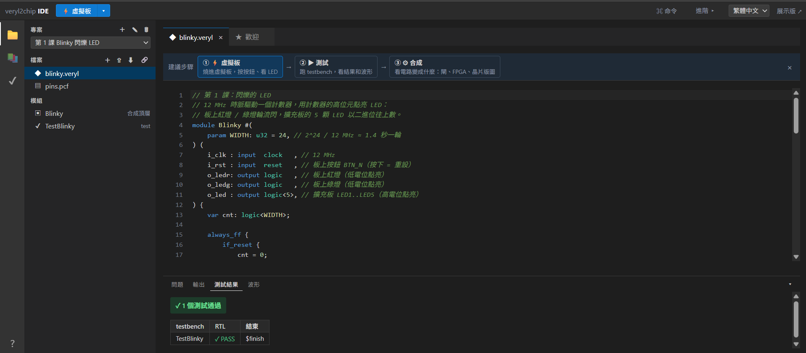

### 2. 波形觀察

查看 `clk`、`rst`、`ledr` 等訊號。波形中可以看到 `clk` 規律切換，其他訊號則依測試情境改變。

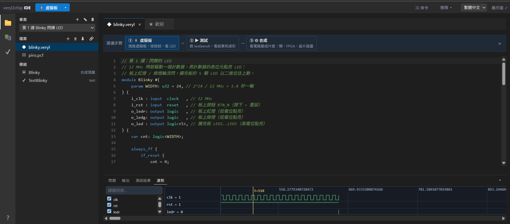

### 3. FPGA 虛擬板

在 iCEBreaker 虛擬板觀察 LED 顯示，了解硬體邏輯在板上輸出的呈現方式。

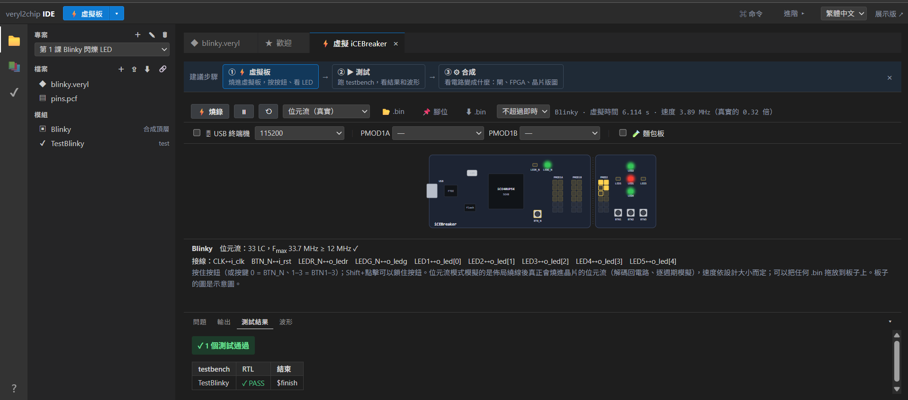

### 4. RTL 邏輯結構

使用「① RTL→Logic」檢視 Blinky 模組與輸入輸出訊號。這是 RTL 結構視圖，並非實體晶片佈局圖。

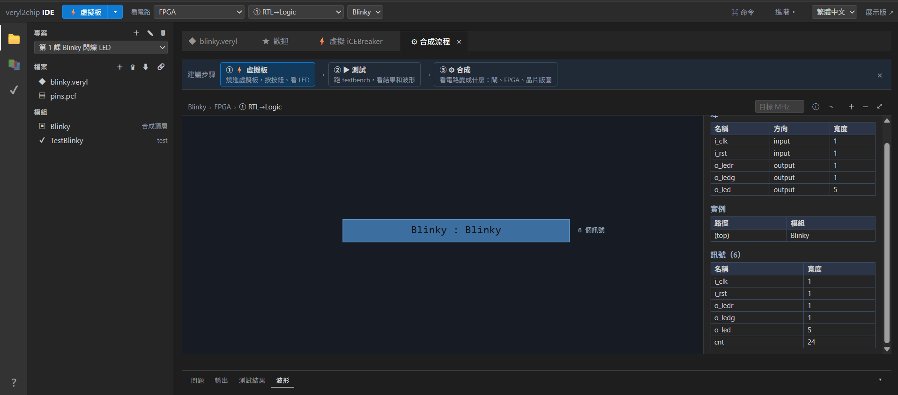

### 5. 技術無關邏輯合成

選擇「③ Tech-indep Syn」，觀察電路展開成各種邏輯元件的結果。

| 元件 | 數量 |
|---|---:|
| DFF | 24 |
| XOR | 23 |
| AND | 22 |
| NOT | 2 |
| **總計** | **71** |

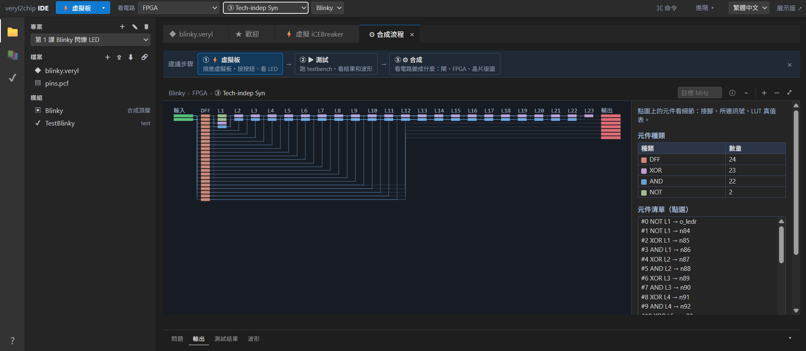

### 6. FPGA LUT4 技術映射

選擇「④ LUT4 Techmap」，畫面顯示 33 個 LUT4 與 24 個 DFFR，總計 57 個映射後元件。兩個階段採用不同的元件表示方式，因此不能直接將 71 與 57 當成相同單位的效率比較。

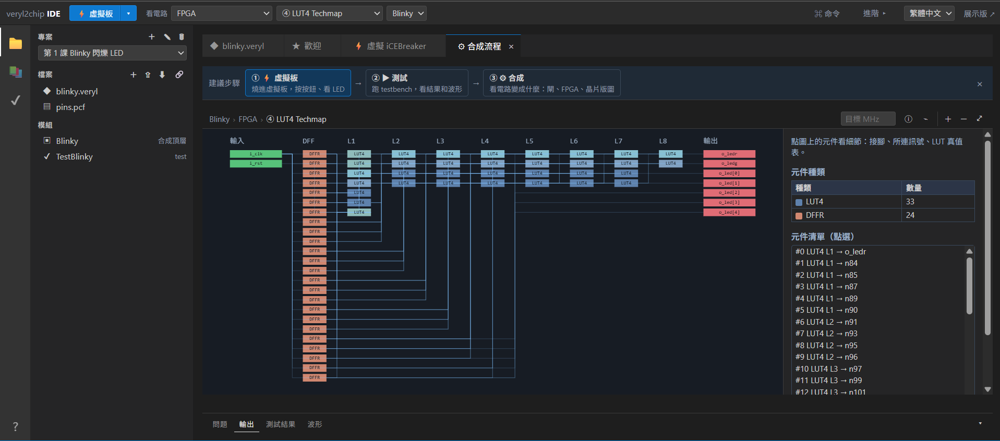

### 7. Placement（元件佈局）

選擇「⑤ Placement 退火」，觀察 FPGA 格點中元件的位置，以及右側列出的 I/O 腳位配置。

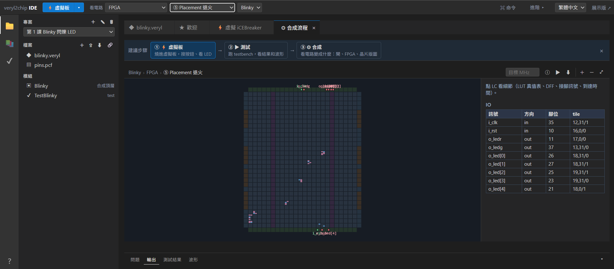

### 8. Routing（繞線）

選擇「⑥ Global+Detail Routing」，觀察元件之間的連線及畫面上標示的路徑。

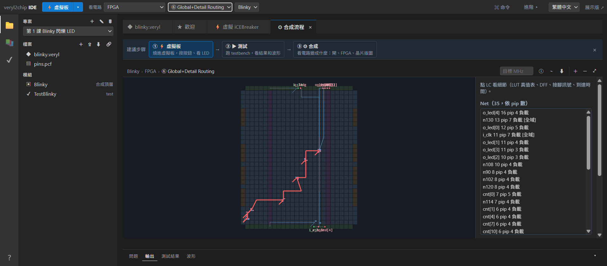

### 9. Timing（STA，靜態時序分析）

選擇「⑦ Timing (STA)」，畫面右側顯示 **關鍵路徑延遲 29.68 ns**，並列出路徑各段的累計延遲、單段延遲及經過元件。這是此次範例工具呈現的分析結果。

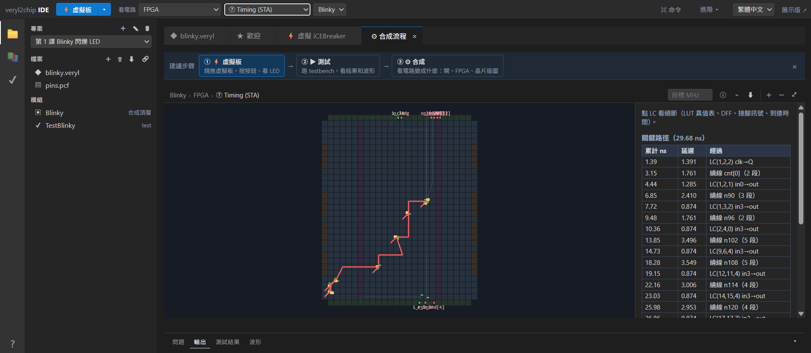

### 10. FPGA 與 ASIC 比較

在「FPGA vs ASIC 比較」畫面中，觀察兩種實現方式的示範估算結果：

| 指標 | FPGA | ASIC |
|---|---:|---:|
| 關鍵路徑延遲 | 29.68 ns | 2.33 ns |
| 最大頻率 Fmax | 33.7 MHz | 429.1 MHz |
| 元件／邏輯資源 | 33 LC、24 DFF | 77 個元件、24 DFF |

這些數值是**本次範例與工具設定下的結果**，不能推論所有 ASIC 的效能一定高於所有 FPGA。

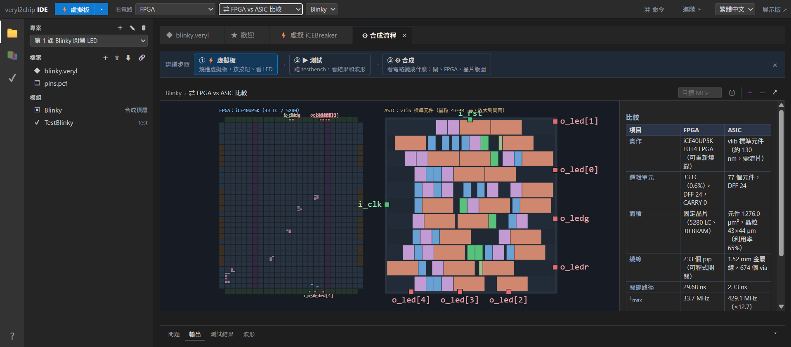

## 七、結果與討論

本次使用兩套線上工具完成基本邏輯閘測試與 Blinky 電路的 EDA 流程觀察：

- AND 邏輯閘的四種輸入組合均符合真值表，測試顯示通過。
- `TestBlinky` 的功能測試顯示 PASS，並可查看時脈及 LED 訊號波形。
- veryl2chip 可以顯示合成、LUT4 映射、佈局、繞線及 STA 等設計階段。
- 範例的 FPGA STA 畫面列出關鍵路徑延遲 29.68 ns，讓我了解訊號傳遞時間也是硬體設計需考慮的因素。

## 八、學習心得

以前學 Nand2Tetris 時，主要是使用 HDL 組合 NAND、NOT、AND 等基本電路。這次從 AND 邏輯閘測試開始，再操作 veryl2chip 的 Blinky 範例，讓我看到電路不只有程式碼，還能觀察模擬波形與後續的合成結果。

我覺得最有收穫的是看到邏輯電路經過 LUT4 映射、佈局、繞線和時序分析的過程，才知道硬體設計除了功能正確，也要考慮元件如何放置、訊號如何連接，以及延遲是否符合要求。這次實作讓我更了解 EDA 在 IC 與 FPGA 設計上的用途。

## 九、參考資料

1. [veryl2chip IDE](https://ccc-eda.github.io/veryl2chip/web/dist/index.html)
2. [nand2tetris HDL 模擬器](https://ccc-js.github.io/hack-computer/dist/hdl.html)
3. [Cornell ECE5745 課程講義](https://www.csl.cornell.edu/courses/ece5745/handouts.html)
4. [ccc-eda/veryl2chip GitHub](https://github.com/ccc-eda/veryl2chip/)
5. [ccc-js/hack-computer GitHub](https://github.com/ccc-js/hack-computer)
